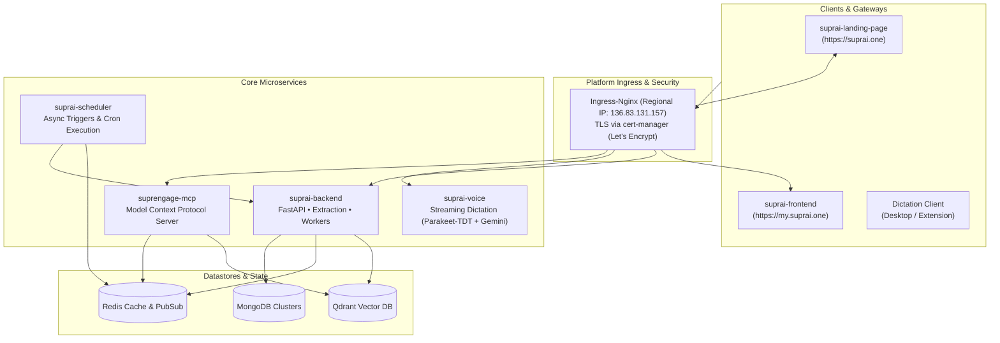

# SuprAI

**Your memory, made intelligent — The AI execution layer for your company.**

One place where every team's apps, answers, and agents come together — so your company can ask, act, and automate as one.

[Website](https://suprai.one) • [Web App](https://my.suprai.one) • [API](https://api.suprai.one) • [Architecture Docs](https://github.com/Supr-AI/suprai-docs)

---

## 🌐 Ecosystem & Architecture Overview

SuprAI is built as a unified, high-performance platform running on Google Cloud Platform (GCP) and Google Kubernetes Engine (GKE). Services are isolated into distinct repositories by functional domain:

---

## 📦 Repository Catalog

### **1. Applications & User Interfaces**
* **[`suprai-landing-page`](https://github.com/Supr-AI/suprai-landing-page)**: Public marketing website and waitlist portal (`suprai.one` and `www.suprai.one`). Multi-stage React/Vite container served via Nginx on GKE.
* **[`suprai-frontend`](https://github.com/Supr-AI/suprai-frontend)**: Core cross-platform web application (`my.suprai.one`). Built with Expo / React Native Web, monorepo with design system tokens and API clients.

### **2. Core Services & AI Engines**
* **[`suprai-backend`](https://github.com/Supr-AI/suprai-backend)**: Central application API (`api.suprai.one`). Python 3.12 FastAPI service with asynchronous background workers for memory extraction and document rendering.
* **[`suprai-voice`](https://github.com/Supr-AI/suprai-voice)**: Low-latency streaming dictation service (`dictation.suprai.one`). Self-hosted CPU inference with Parakeet-TDT and Silero VAD, leveraging Gemini 1.5 Flash via Vertex AI for smart text refinement.
* **[`suprai-scheduler`](https://github.com/Supr-AI/suprai-scheduler)**: Reliable scheduled tasks, cron automation, and background event triggers.
* **[`suprengage-mcp`](https://github.com/Supr-AI/suprengage-mcp)**: Model Context Protocol (MCP) server enabling intelligent AI agents to securely interact with customer integrations, memory, and actions.

### **3. Infrastructure & Platform**
* **[`suprai-platform`](https://github.com/Supr-AI/suprai-platform)**: Shared Kubernetes configurations managed via Helm. Manages cluster-wide add-ons: Ingress-Nginx, cert-manager (Let's Encrypt), Qdrant vector database, Redis, and observability (Prometheus, Grafana, Loki, Tempo).
* **[`suprai-infra`](https://github.com/Supr-AI/suprai-infra)**: Infrastructure-as-code (Terraform) provisioning GCP VPC, GKE private cluster, regional static IPs, service accounts, and Artifact Registry.

### **4. Knowledge & Tooling**
* **[`suprai-docs`](https://github.com/Supr-AI/suprai-docs)**: Central technical architecture records, memory processing specifications, database models, and research documentation.
* **[`.github`](https://github.com/Supr-AI/.github)**: Organization profile and shared organization configuration.

---

## 🔒 Architectural Principles

- **Ingress & TLS:** All public HTTP/HTTPS traffic routes through a single Regional Static IP via `ingress-nginx` with automated Let's Encrypt SSL/TLS certificates issued by `cert-manager`.
- **Zero Trust Network Policies:** Kubernetes namespaces enforce default-deny network ingress policies. Backend workloads only accept traffic from explicit sources (e.g. `ingress-nginx` controller).
- **Cost Efficiency:** Infrastructure maintains a strict target of $\le \$300$/month (hard ceiling of $\$350$/month) with right-sized CPU/memory requests and automated scaling.
- **Unified CI/CD:** Native PowerShell (`deploy.ps1`) and Bash (`deploy.sh`) scripts paired with Google Cloud Build for deterministic, multi-architecture container builds pushed to Google Artifact Registry.

---

  © SuprAI Organization. All rights reserved.

